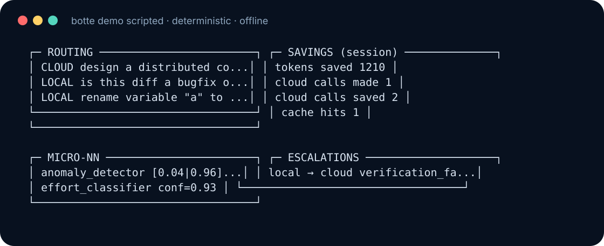

[](https://github.com/zedarvates/botte-secrete)

# Botte Secrète

**Des outils pour aider les agents de développement à réduire le contexte répété,
choisir un traitement adapté et vérifier les preuves d'un travail terminé.**
Disponibles en Python, en CLI et par MCP ; les modèles locaux et les fournisseurs
cloud sont des intégrations facultatives.

[](https://github.com/zedarvates/botte-secrete/actions)
[](https://www.python.org/)
[](pyproject.toml)
[](LICENSE)

[English](README.md) · [Essayer](#essayer-la-démonstration-hors-ligne) · [Plugin Codex](#connecter-votre-agent) · [Fonctions](docs/capabilities.fr.md) · [Documentation](docs/README.md)

## À quoi peut-il servir ?

- Compacter les journaux, le JSON et les sorties d'outils en conservant les
  garanties documentées sur leur contenu.
- Obtenir un conseil de routage ou configurer un serveur de modèle local existant.
- Inspecter la configuration d'un projet et demander des preuves de réalisation.

Le projet est en **bêta**. Commencez par un exemple limité et vérifiez le résultat
dans votre environnement. Un conseil de modèle, un serveur configuré et un test
réussi sur données préparées ne prouvent pas la même chose.

## Essayer la démonstration hors ligne

Prérequis : **Python 3.10+ et Git**. La version publiée recommandée est
[**v1.11.1**](https://github.com/zedarvates/botte-secrete/releases/tag/v1.11.1).
Exécutez ces commandes depuis un nouveau dossier de travail, hors d'un dépôt
Botte existant. Elles fixent son commit publié dans un nouvel environnement virtuel.

Linux / macOS :

```bash
python3 -m venv .venv
source .venv/bin/activate
python -m pip install "git+https://github.com/zedarvates/botte-secrete.git@2704094f5917b0f5d384b571f195db5968c4811b"
python -m skills.demo.cli scripted --speed 0 --no-clear
```

Windows PowerShell :

```powershell
python -m venv .venv
.\.venv\Scripts\python.exe -m pip install "git+https://github.com/zedarvates/botte-secrete.git@2704094f5917b0f5d384b571f195db5968c4811b"
.\.venv\Scripts\python.exe -m skills.demo.cli scripted --speed 0 --no-clear
```

**Résultat attendu :** un tableau de bord en terminal montre des choix local/cloud,
un accès au cache et une escalade à partir d'un scénario fixe. La démonstration
n'appelle **aucun modèle ni réseau** ; ses compteurs d'économies et d'appels cloud
proviennent de données préparées.



Pour voir de vrais tests s'exécuter, suivez la
[démonstration des preuves de réalisation](docs/demos/completion-proof/README.md) :
une annonce préparée est signalée, un test échoue, puis une correction préparée
fait réussir trois tests. Le détecteur seul contrôle les marqueurs déclarés ;
le [vérificateur de reçus](skills/completion_proof/VERIFICATION.md), distinct,
contrôle les fichiers avec une référence fournie par un exécuteur de confiance.

## Connecter votre agent

| Composant | Rôle | Par où commencer |
|---|---|---|
| Runtime Botte Secrète | Outils, CLI, contrôles et serveur MCP | L'installation ci-dessus |
| Plugin Codex | Consignes de travail et connexion au runtime installé séparément | [Guide de la version publiée](https://github.com/zedarvates/botte-secrete/blob/v1.11.1/plugins/botte-secrete/README.md) |
| [Parcimonia](https://github.com/zedarvates/parcimonia) | Projet distinct pour le choix entre traitements candidats, les contrats de preuve et des API d'exécution bornée | [README Parcimonia](https://github.com/zedarvates/parcimonia#readme) |

Botte inclut des outils consultatifs du workflow Parcimonia. Installer l'un des
dépôts n'installe pas l'autre dépôt et ne configure pas automatiquement un modèle
local. Pour travailler sur les sources, consultez le
[guide du plugin correspondant](plugins/botte-secrete/README.md).
Gardez le plugin et le runtime sur la même version ou le même commit relu et
rendez `botte-mcp` accessible dans le PATH de l'agent.

Pour les autres clients MCP, lisez le [guide MCP](docs/mcp-integration.md).
La commande facultative `botte bootstrap /path/to/your-project` écrit la
configuration et les rapports du projet sous `.botte/`, en conservant les
serveurs MCP sans rapport. Ne versionnez pas la configuration propre à la machine.

## Adaptez Botte Secrète à vos usages

Je vous conseille de demander à votre assistant IA (votre « super intelligence »)
d'étudier ce dépôt et de l'adapter à vos objectifs, méthodes de travail, outils,
matériel et contraintes, plutôt que de le reprendre tel quel. Sélectionnez les
composants utiles et vérifiez les adaptations dans votre environnement.

Copiez cette consigne et remplissez les crochets :

```text
Étudie ce dépôt pour mon usage : [objectifs et méthodes de travail]. Mes machines
et outils sont [OS, CPU/GPU, RAM, modèles, agent et services]. Mon budget en temps
et en coût est [budget] et mes contraintes de confidentialité sont [données à
garder en local]. Identifie les composants utiles, leurs prérequis et leurs
limites actuelles. Propose une petite installation et vérifie une tâche
représentative. Si c'est utile, coordonne mon cloud, un Space ChatGPT et mes
machines locales avec les connecteurs et accès disponibles. Précise où chaque
composant s'exécute et configure la stratégie de mise à jour et de synchronisation
du code, de la configuration et de la documentation, en indiquant ce qui est
partagé et ce qui reste local.
```

Le [guide de configuration portable](docs/adaptive-local-runtime.md) couvre
l'inventaire local, les profils par tâche et les adaptateurs de mémoire existante.
La synchronisation cloud/Space/local est une intégration à configurer pour votre
environnement.

## Fonctions et limites

| Fonction | Limite actuelle | Détails |
|---|---|---|
| Réduction du contexte | Valeurs JSON et lignes distinctes des journaux conservées ; tailles en octets UTF-8, pas en tokens facturés. Les originaux de la CLI restent dans le processus. | [Protocole d'intégrité](docs/plans/2026-09-13-compression-integrity.md) |
| Routage et modèles locaux | Les conseils et les serveurs configurés demandent une vérification par tâche ; le matériel seul ne prouve pas la qualité du modèle. | [Configuration locale](docs/adaptive-local-runtime.md) |
| Micro-NN et mémoire des assets | Les petits prédicteurs conseillent ; le k-NN des assets reste en observation. | [Transparence et fonctions détaillées](docs/capabilities.fr.md) |
| Preuves de réalisation | La détection de marqueurs et la vérification des fichiers ont des limites de confiance distinctes. | [Contrat de vérification](skills/completion_proof/VERIFICATION.md) |
| Économies | Le benchmark fourni utilise des échantillons synthétiques. Les gains réels de coût et de qualité doivent être mesurés sur votre travail. | [Périmètre du benchmark](docs/capabilities.fr.md#benchmark-mesuré) |

Les traitements déterministes locaux n'exigent aucun identifiant cloud.
Aucun suivi produit, démon, démarrage automatique ou tâche planifiée n'est
installé par défaut. Consultez le
[tableau d'impact système](docs/capabilities.fr.md#sécurité-et-impact-système).

## Choisir une version

| Source | Usage |
|---|---|
| [Version stable v1.11.1](https://github.com/zedarvates/botte-secrete/releases/tag/v1.11.1) | Installation publiée recommandée ; les notes relient les fichiers et les limites de validation. |
| Ces sources (`1.11.0` dans [pyproject.toml](pyproject.toml)) | Développement ; le numéro seul n'identifie pas la version publiée. Conservez le SHA des sources. |
| [Branche pilote 2.0.0rc2](https://github.com/zedarvates/botte-secrete/releases/tag/v2.0.0rc2) | Préversion historique distincte pour des pilotes Factory Assurance limités ; lire son périmètre et ses preuves. |

La version stable consigne une validation Windows et Ubuntu sous WSL. Elle ne
prouve pas la compatibilité macOS native, ARM/Pi, les performances GPU ni des
gains généraux de qualité. Chaque version conserve ses preuves ; le badge
ci-dessus décrit ces sources.

## Documentation et contribution

| Objectif | Guide |
|---|---|
| Parcourir la documentation | [Index](docs/README.md) |
| Consulter modules, modèles, Monte Cristo et benchmarks | [Fonctions détaillées](docs/capabilities.fr.md) |
| Comprendre les flux et les limites de confiance | [Architecture](docs/ARCHITECTURE.md) |
| Connecter une mémoire commune | [API mémoire et pont MCP](docs/shared-memory.md) |
| Connecter Hermes | [Intégration Hermes](docs/integrations/hermes.md) |
| Développer, lancer les contrôles ou signaler un problème reproductible | [Développement](docs/DEVELOPMENT.md) · [Contribuer](CONTRIBUTING.md) |
| Consulter les changements | [Changelog](CHANGELOG.md) · [Versions](https://github.com/zedarvates/botte-secrete/releases) |

Pour une question ou un bug, [ouvrez une issue](https://github.com/zedarvates/botte-secrete/issues)
avec la version des sources, l'environnement et une reproduction sans données
privées. Signalez les vulnérabilités en privé selon [SECURITY.md](SECURITY.md).
Les plans et recherches restent des propositions tant qu'une preuve
d'implémentation ne les accompagne pas.

Distribué sous [licence MIT](LICENSE). Créé par
[Sylvain Galliez](https://github.com/zedarvates).
