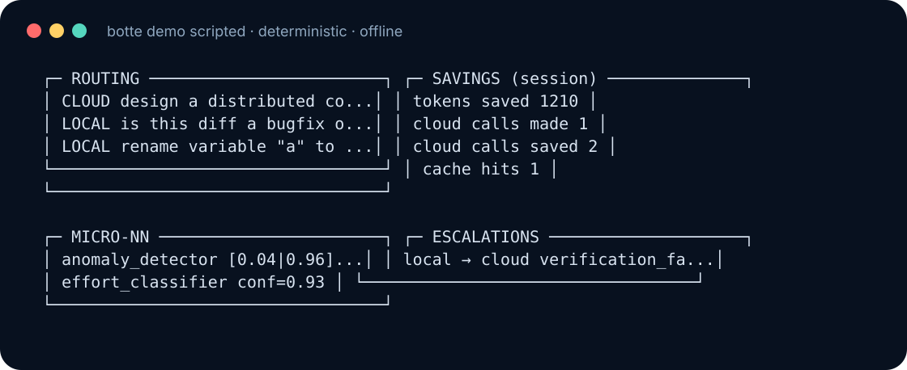

[](https://github.com/zedarvates/botte-secrete)

# Botte Secrète

**Tools for coding agents to reduce repeated context, choose a suitable execution
path and check the evidence behind completed work.** Available through Python,
a CLI and MCP; local models and cloud providers are optional integrations.

[](https://github.com/zedarvates/botte-secrete/actions)
[](https://www.python.org/)
[](pyproject.toml)
[](LICENSE)

[Français](README.fr.md) · [Try it](#try-the-offline-demo) · [Codex plugin](#connect-your-agent) · [Capabilities](docs/capabilities.md) · [Documentation](docs/README.md)

## What can I use it for?

- Compact logs, JSON and tool output while preserving the documented content
  guarantees.
- Ask for routing advice or configure an existing local model backend.
- Inspect a project's configuration and require evidence for completion claims.

The project is in **beta**. Start with a bounded example and check the result in
your environment. Model advice, a configured endpoint and a passing fixture
each establish different things.

## Try the offline demo

Requires **Python 3.10+ and Git**. The recommended published release is
[**v1.11.1**](https://github.com/zedarvates/botte-secrete/releases/tag/v1.11.1).
Run these commands from a new working directory outside an existing Botte
checkout. They pin its published source commit in a new virtual environment.

Linux / macOS:

```bash
python3 -m venv .venv
source .venv/bin/activate
python -m pip install "git+https://github.com/zedarvates/botte-secrete.git@2704094f5917b0f5d384b571f195db5968c4811b"
python -m skills.demo.cli scripted --speed 0 --no-clear
```

Windows PowerShell:

```powershell
python -m venv .venv
.\.venv\Scripts\python.exe -m pip install "git+https://github.com/zedarvates/botte-secrete.git@2704094f5917b0f5d384b571f195db5968c4811b"
.\.venv\Scripts\python.exe -m skills.demo.cli scripted --speed 0 --no-clear
```

**Expected result:** a terminal dashboard shows local/cloud routing, a cache hit
and an escalation from a fixed scenario. The demo calls **no model and no
network**; its displayed savings and cloud-call counters are fixture data.



For an example with actual test execution, follow the
[completion-proof walkthrough](docs/demos/completion-proof/README.md):
a prepared completion claim is flagged, a test fails, and a prepared correction
passes three tests. The detector alone checks declared markers; the separate
[receipt verifier](skills/completion_proof/VERIFICATION.md) checks artifacts
against a reference supplied by a trusted executor.

## Connect your agent

| Component | Role | Start here |
|---|---|---|
| Botte Secrète runtime | Tools, CLI, checks and MCP server | The installation above |
| Codex plugin | Workflow instructions and a connection to the separately installed runtime | [Published plugin guide](https://github.com/zedarvates/botte-secrete/blob/v1.11.1/plugins/botte-secrete/README.md) |
| [Parcimonia](https://github.com/zedarvates/parcimonia) | Separate project for candidate routing, evidence contracts and bounded execution APIs | [Parcimonia README](https://github.com/zedarvates/parcimonia#readme) |

Botte includes advisory Parcimonia workflow tools. Installing either repository
does not install the other repository or configure a local model automatically.
For a source checkout, use the [matching plugin guide](plugins/botte-secrete/README.md).
Keep the plugin and runtime on the same reviewed release or commit, and make
`botte-mcp` available on the agent's PATH.

For other MCP clients, read [MCP integration](docs/mcp-integration.md). The
optional `botte bootstrap /path/to/your-project` command writes project-local
configuration and reports under `.botte/`, preserving unrelated MCP servers.
Keep machine-specific configuration out of version control.

## Adapt Botte Secrète to your own use

I recommend asking your AI assistant (your “superintelligence”) to study this
repository and adapt it to your own goals, workflows, tools, hardware and
constraints, rather than adopting it unchanged. Select the useful components
and verify the adaptations in your environment.

Copy this prompt and fill in the brackets:

```text
Study this repository for my use: [goals and workflow]. My machines and tools
are [OS, CPU/GPU, RAM, models, agent and services]. My time and cost budget is
[budget], and my privacy constraints are [data that must stay local].
Identify the useful components, their prerequisites and their current limits.
Propose a small setup and verify one representative task. If useful, coordinate
my cloud, a ChatGPT Space and local machines through the available connectors
and access. Specify where each component runs and configure the update and
synchronization strategy for code, configuration and documentation, including
what is shared and what stays local.
```

The [portable runtime guide](docs/adaptive-local-runtime.md) covers local
inventory, task-specific profiles and existing memory adapters. Cloud/Space/local
synchronization is an integration to configure for your environment.

## Capabilities and limits

| Capability | Current boundary | Details |
|---|---|---|
| Context reduction | JSON values and distinct log lines are preserved; sizes are UTF-8 bytes, not billed tokens. CLI originals are process-local. | [Integrity protocol](docs/plans/2026-09-13-compression-integrity.md) |
| Routing and local models | Advice and configured backends need task-specific verification; hardware alone does not establish model quality. | [Runtime setup](docs/adaptive-local-runtime.md) |
| Micro-NN and asset memory | Small predictors advise; the asset k-NN baseline remains in shadow mode. | [Model transparency and capabilities](docs/capabilities.md) |
| Completion evidence | Marker detection and artifact verification have separate trust boundaries. | [Verification contract](skills/completion_proof/VERIFICATION.md) |
| Savings | The supplied benchmark uses synthetic samples. Real cost and quality gains require measurements on your workload. | [Benchmark scope](docs/capabilities.md#measured-benchmark) |

Local deterministic workflows need no cloud credentials. No product analytics,
daemon, startup entry or scheduled task is installed by default. See the
[system-impact table](docs/capabilities.md#safety-and-system-impact).

## Choose a version

| Source | Use |
|---|---|
| [v1.11.1 stable release](https://github.com/zedarvates/botte-secrete/releases/tag/v1.11.1) | Recommended published installation; release notes link artifacts and validation limits. |
| This checkout (`1.11.0` in [pyproject.toml](pyproject.toml)) | Source development; its version label alone does not identify the published release. Retain the source SHA. |
| [2.0.0rc2 pilot track](https://github.com/zedarvates/botte-secrete/releases/tag/v2.0.0rc2) | Separate historical pre-release for bounded Factory Assurance pilots; read its own scope and evidence. |

The stable release records Windows and Ubuntu-under-WSL validation. It does not
establish native macOS, ARM/Pi, GPU performance or general quality gains.
Version-specific evidence lives with each release; the badge above describes
this source tree.

## Documentation and contribution

| Goal | Guide |
|---|---|
| Browse all documentation | [Documentation hub](docs/README.md) |
| Inspect modules, models, Monte Cristo and benchmarks | [Detailed capabilities](docs/capabilities.md) |
| Understand data flow and trust boundaries | [Architecture](docs/ARCHITECTURE.md) |
| Connect shared memory | [Memory API and MCP bridge](docs/shared-memory.md) |
| Connect Hermes | [Hermes integration](docs/integrations/hermes.md) |
| Develop, run checks or report a reproducible issue | [Development](docs/DEVELOPMENT.md) · [Contributing](CONTRIBUTING.md) |
| Review changes | [Changelog](CHANGELOG.md) · [Releases](https://github.com/zedarvates/botte-secrete/releases) |

For questions or bugs, [open an issue](https://github.com/zedarvates/botte-secrete/issues)
with your source version, environment and a sanitized reproduction. Report
vulnerabilities privately through [SECURITY.md](SECURITY.md). Plans and research
documents describe proposals unless explicitly backed by implementation evidence.

Released under the [MIT License](LICENSE). Created by
[Sylvain Galliez](https://github.com/zedarvates).
