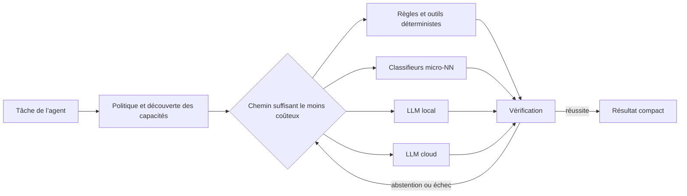
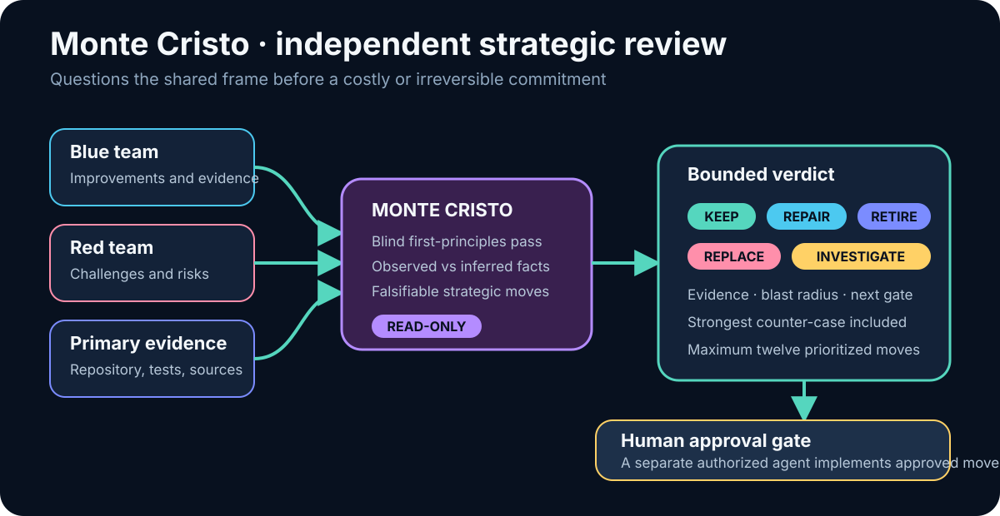
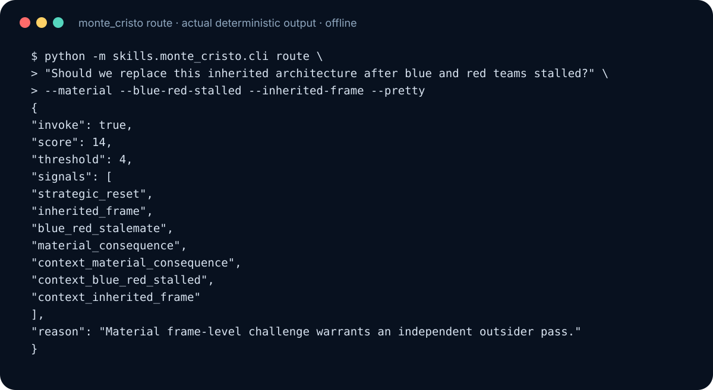
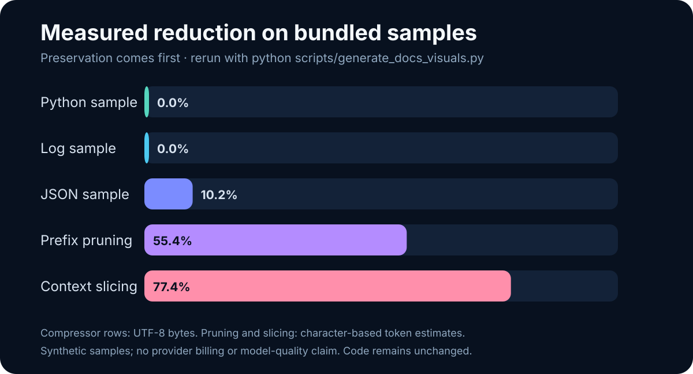
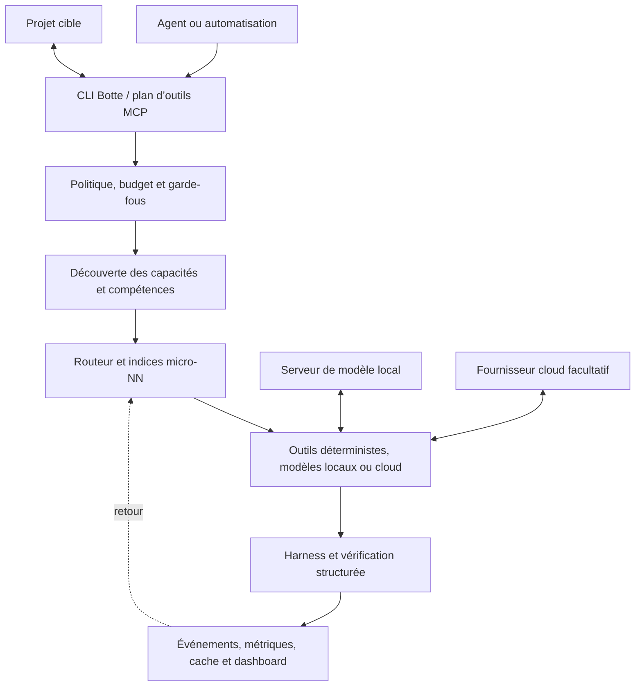

# Fonctions et preuves de Botte Secrète

[Retour au README](../README.fr.md) · [English](capabilities.md)

Ce guide conserve les détails techniques du README des sources. Pour une version
publiée, utilisez ses sources, contrats de fonctions et preuves datées.

## Comprendre et inspecter les petits modèles

**Le code et les poids des micro-NN sont ouverts et consultables.** Ces petits
prédicteurs aident à choisir un traitement ou à comparer un asset avec des
exemples antérieurs. Leur réponse est un conseil : elle ne prouve pas qu'une
tâche est correcte ou terminée.

| Mécanisme | Explication simple | Ce que l'on peut consulter |
|---|---|---|
| **Micro-NN** — petit réseau de neurones | Un petit calculateur transforme des caractéristiques numériques, comme la complexité d'une tâche, en catégorie ou en score. Ses **poids et biais** sont les nombres appris qui servent à ce calcul. Il ne génère pas de texte. | [Poids JSON](../skills/botte_nn/models/), [extraction des caractéristiques](../skills/botte_nn/features.py), [code de calcul](../skills/botte_nn/cli.py) et [entraînement](../skills/botte_nn/training/) |
| **k-NN** — k plus proches voisins | Recherche les exemples vérifiés les plus ressemblants, puis utilise leurs résultats pour proposer un avis. La mémoire qualité des assets montre ses voisins et s'abstient si les exemples sont insuffisants. | [Code de comparaison et de mémoire](../skills/asset_quality/memory.py), [fonctionnement](../skills/asset_quality/SKILL.md) et [exemple public](../examples/asset-quality/mesh-report.json) |

Par exemple, un micro-NN peut conseiller un traitement local pour une tâche
simple. Le k-NN peut comparer un rapport de maillage à des maillages déjà vérifiés
de la même famille. Les contrôles déterministes et la politique de vérification
applicable restent nécessaires.

### Les fichiers publics sur Hugging Face

| Dépôt public | Ce qui est réellement accessible |
|---|---|
| [Botte Nano-NN](https://huggingface.co/zedgamer/botte-nano-nn) | [Six fichiers de poids JSON](https://huggingface.co/zedgamer/botte-nano-nn/tree/main/models), lisibles dans le navigateur et téléchargeables ; par exemple [binary_router.json](https://huggingface.co/zedgamer/botte-nano-nn/blob/main/models/binary_router.json). La fiche déclare la licence MIT. |
| [Asset Quality Memory k-NN](https://huggingface.co/zedgamer/asset-quality-memory-knn) | [Une fiche publique et les liens vers le code](https://huggingface.co/zedgamer/asset-quality-memory-knn/tree/main). Ce k-NN n'a pas de fichier de poids neuronaux : sa mémoire d'exemples reste locale au projet et n'est pas publiée. |

L'accès public a été vérifié sans identifiants le **14 septembre 2026**.
Les six modèles du Hub constituent un instantané **différent des onze fichiers
JSON présents dans ce dépôt GitHub**. Utiliser les poids et les caractéristiques
de la même version ; consulter l'[inventaire daté](model-transparency-check.json)
et les [règles de publication et de provenance](huggingface-publication.md).

L'ouverture permet d'inspecter le fonctionnement ; elle ne garantit ni la
précision ni la maturité en production. La [roadmap de validation](plans/2026-08-06_micro-nn-grounding-roadmap.md)
précise les exigences. Le code est sous [licence MIT](../LICENSE), également
déclarée par les fiches publiques du Hub. Comprendre l'algorithme ne nécessite
pas de partager sa mémoire privée d'exemples.

## Pourquoi Botte Secrète ?

Les agents consomment souvent des tokens coûteux pour des opérations qui ne
nécessitent pas un grand modèle : classer une demande, choisir un outil,
dédupliquer un journal, vérifier un schéma ou retrouver un résultat exact.
Botte ajoute une couche de décision peu coûteuse avant l’appel au modèle.



Le principe par défaut est : **utiliser le chemin vérifiable le moins cher**.
Local ne signifie pas fiable par nature ; les résultats passent encore par des
contrôles structurés, des preuves ou une escalade explicite.

## Ce que contient le projet

| Domaine | Fonction | Point d’entrée |
|---|---|---|
| Routage | Choisit une exécution déterministe, locale ou cloud | `botte route` |
| Mémoire qualité | Apprend des résultats vérifiés et explique les conseils k-NN en observation | `botte qa` |
| Qualité des assets | Contrôle et compare images, textures, maillages, animations et paquets Godot | `botte asset-qa` |
| Diagnostic | Vérifie politique, directives, métriques, sécurité et dérive | `botte doctor` |
| Réduction du contexte | Compresse journaux, JSON, sorties d’outils et contexte sélectionné | `universal_compressor`, `context_budget` |
| Ceinture micro-NN | Fournit des indices de routage avec de petits classifieurs, pas des LLM | `botte belt` |
| Modèles locaux | Détecte les serveurs compatibles OpenAI, dont LM Studio et Ollama | `llm_backends` |
| Inférence locale adaptable | Configure des profils par tâche et réutilise une mémoire commune ou externe | `botte runtime` |
| MCP | Expose routage, découverte, audit et optimisation sur stdio | `botte-mcp` |
| Dashboard | Affiche les instantanés publics et les mesures locales | `botte dashboard` |
| Regard stratégique | Remet en question les hypothèses partagées par les équipes bleue et rouge avant une décision coûteuse | `monte_cristo` |

Les contrats détaillés vivent dans `skills/<nom>/SKILL.md`. Les flux entre
modules et les frontières de confiance sont décrits dans le
[guide d’architecture](ARCHITECTURE.md).

## Configurer Botte avec votre propre LLM

Pour faire adapter Botte par **votre propre LLM**, consultez le
[guide de configuration portable](adaptive-local-runtime.md). Il fournit
une consigne en français à copier, un inventaire local, des profils validables
hors ligne et des adaptateurs pour votre mémoire existante. Les comparatifs
mesurent des moteurs déjà configurés ; aucun gain ni support spéculatif n'est
présumé à partir du seul matériel déclaré.

```bash
botte runtime inspect
botte runtime template --topology single --memory none
```

## Agent stratégique : Monte Cristo

**Monte Cristo est le regard stratégique indépendant et en lecture seule de
Botte Secrète.** Les agents de l’équipe bleue améliorent le système et ceux de
l’équipe rouge le contestent ; Monte Cristo prend du recul lorsque les deux
équipes risquent de partager les mêmes hypothèses héritées.



_Schéma de gouvernance maintenu ; il décrit les limites d’autorité et
d’approbation, pas une trace d’exécution._

Utilisez-le avant une refonte d’architecture coûteuse, un programme de recherche,
une migration ou une décision dominée par les coûts déjà engagés. Ne l’utilisez
pas pour une revue de code ordinaire ou une correction étroite déjà vérifiée. Il
retourne des propositions bornées `KEEP`, `REPAIR`, `REPLACE`, `RETIRE` ou
`INVESTIGATE`, accompagnées de preuves et d’un prochain test. Il ne peut ni
modifier, déployer, acheter, publier, ni exécuter ses recommandations : toute
décision conséquente exige une approbation humaine et un agent d’implémentation
séparé.



_Capture CLI reproductible issue de l’évaluateur de routage déterministe hors
ligne ; elle prouve le câblage d’activation, pas la qualité de verdicts ouverts._

```bash
python -m skills.monte_cristo.cli route "Faut-il remplacer cette architecture héritée ?" --material --pretty
python -m skills.monte_cristo.cli template "Réévaluer la direction de la plateforme" --pretty
python -m skills.monte_cristo.cli eval --pretty
```

Consultez la [définition de l’agent](../agents/monte-cristo.md), le
[guide d’utilisation](../skills/monte_cristo/README.md) et le
[contrat de rapport validé](../skills/monte_cristo/report.schema.json).

## Benchmark mesuré

Le benchmark fourni teste compression, élagage, sélection de contexte et
micro-NN sur un corpus synthétique fixe. Il sert à repérer les régressions et ne
promet pas le même résultat pour chaque dépôt.

L'activation suit la
[roadmap de grounding](plans/2026-08-06_micro-nn-grounding-roadmap.md) :
aucun nouveau micro-NN n'est activé tant qu'un modèle existant n'a pas une
source de labels auditable, des verdicts de production, une calibration et un
rollback. Utilisez `checkup` ou
`python -m skills.nn_audit.cli skills/botte_nn --json` pour l'état courant.

Les Asset Factories peuvent utiliser la [mémoire qualité des assets](../skills/asset_quality/SKILL.md) :
les contrôles déterministes d'intégrité et de licence passent d'abord, puis un
k-NN explicable et isolé par famille conseille en mode observation. Un
[rapport de maillage complet](../examples/asset-quality/mesh-report.json) est
fourni. Aucun octet d'asset ni chemin local n'entre dans la mémoire vérifiée.

Le dépôt MIT existant
[Botte Nano-NN sur Hugging Face](https://huggingface.co/zedgamer/botte-nano-nn)
héberge un instantané portable du format micro-NN. Le code source, les contrats
de caractéristiques, les tests et l'état de maturité restent autoritaires ici.
La [fiche k-NN des assets sur Hugging Face](https://huggingface.co/zedgamer/asset-quality-memory-knn)
est publique ; voir la
[check-list de publication](huggingface-publication.md).



_Mesure effectuée sur les échantillons synthétiques fournis ; les résultats
varient selon le contenu. Consultez les [notes de provenance et de régénération](screenshots-plan.md)._

Régénérez le graphique et la capture de routage :

```bash
python scripts/generate_docs_visuals.py
python scripts/benchmark_full.py --json
```

Le code reste intact. Le JSON conserve toutes ses valeurs et les logs gardent
leurs lignes distinctes dans l'ordre. Les tailles sont des octets UTF-8, pas des
tokens facturés. Les originaux restent en mémoire du processus jusqu'à son arrêt
ou au vidage du stockage ; la CLI ne fournit pas de restauration persistante.
Voir le [protocole de comparaison](plans/2026-09-13-compression-integrity.md).

## Architecture résumée



Botte ne possède ni l’agent, ni le dépôt cible, ni le serveur de modèle, ni le
fournisseur cloud. Le [guide d’architecture](ARCHITECTURE.md) détaille les
flux, frontières de confiance et modules de référence.

## Sécurité et impact système

| Surface | Comportement par défaut |
|---|---|
| Réseau | Aucun accès pour les flux déterministes ; les modèles et opérations `--fresh` sont explicites |
| Télémétrie | Aucun suivi produit ni appel automatique à un service distant |
| Services | Aucun démon, démarrage automatique, `sudo` ou tâche planifiée par défaut |
| Projets cibles | Le bootstrap fusionne la configuration MCP sans remplacer les serveurs sans rapport |
| Événements locaux | Stockés sous `.botte/` dans le projet cible lorsque la fonction est utilisée |
| Vue multi-projets | Registre volontaire ; aucune découverte globale du système de fichiers |
| Identifiants cloud | Lus dans l’environnement par les adaptateurs ; inutiles pour les flux locaux |

Signalez toute vulnérabilité en privé selon [SECURITY.md](../SECURITY.md).

